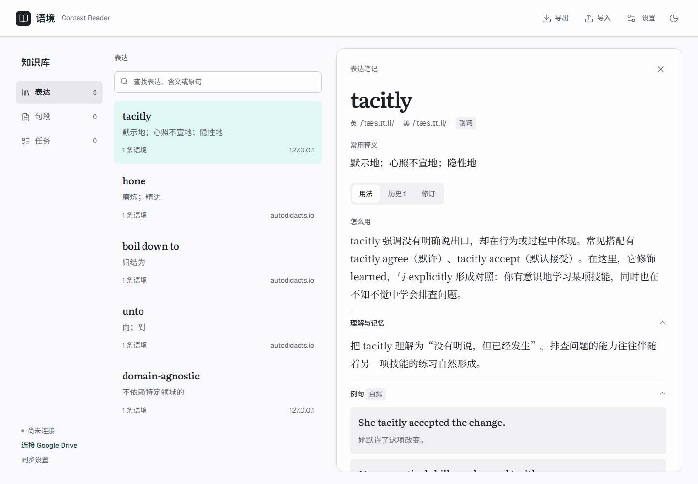
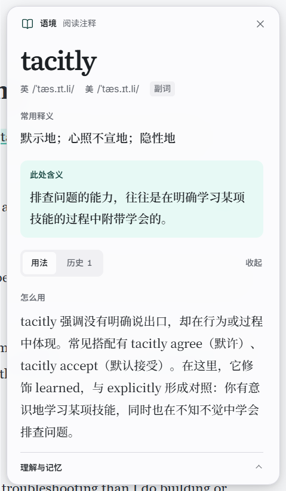
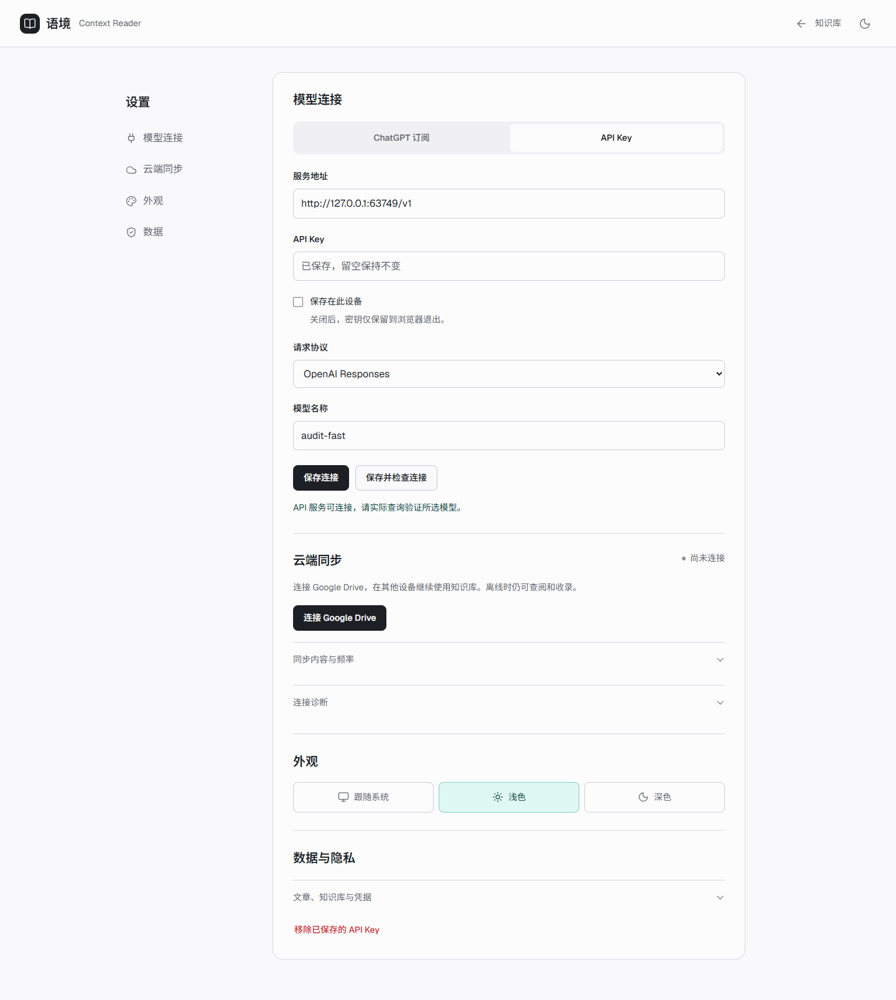

# 语境 Context Reader

[](https://github.com/Foolish-Han/ContextReader/actions/workflows/ci.yml)
[](https://github.com/Foolish-Han/ContextReader/releases/latest)

在英文原文中理解词句，保留自己的用法与语境积累。

A Chrome extension for contextual English reading, asynchronous LLM explanations, and a personal knowledge library with Google Drive sync.

[下载安装](https://github.com/Foolish-Han/ContextReader/releases/latest) | [使用与排错](docs/troubleshooting.md) | [开发指南](docs/development.md) | [路线图](docs/roadmap.md) | [反馈问题](https://github.com/Foolish-Han/ContextReader/issues/new/choose)

## 阅读流程

1. 划选不懂的词、短语或句段，点击“解释并收录”。先得到常用释义和本处含义，学习资料随后补齐。
2. 继续阅读，也可以马上提交另一个表达。关闭浮框或文章不会取消已提交的任务。
3. 再次遇到已收录表达，页面自动标记。悬停查看简义，自愿展开用法、记忆辅助、例句和历史语境。
4. 释义不合适时解释新的语境；生成异常时重新生成。知识库支持人工修订、暂停标记、搜索、导入和导出。

所有普通 HTTP / HTTPS 网页默认启用。不需要时在扩展弹窗停用该网站。页面匹配、悬停和翻历史不调用模型。

## 界面预览

以下是实际扩展渲染，内容使用模拟模型和账号数据。



<details>
<summary>阅读浮框、深色模式与设置</summary>





</details>

## 安装

当前是可加载试用版，尚未上架 Chrome Web Store。API Key 模式只需要 Chrome；ChatGPT 订阅模式还需要 Windows 和 Node.js 22+。

1. 从 [Releases](https://github.com/Foolish-Han/ContextReader/releases/latest) 下载 `context-reader-版本号.zip`，解压到长期使用的目录。
2. 打开 `chrome://extensions`，开启“开发者模式”，点击“加载已解压的扩展程序”，选择解压目录里的 `dist`。
3. 打开扩展设置，选择下方一种模型连接方式。刷新英文文章，划选词句即可使用。

升级时保留同一个安装目录与扩展 ID，在扩展管理页重新加载，再刷新文章。源码使用者按[开发指南](docs/development.md)构建主目录的 `dist`。Chrome 内部页、扩展页、内置 PDF 等受保护页面无法注入。

### API Key

填写 API Key、服务地址、模型名称和请求协议。支持 OpenAI Responses 和兼容的 Chat Completions。

API Key 使用对应服务的 API 额度。默认只保存到浏览器退出；可选择保存在当前设备。检查连接读取服务目录，实际解释验证所选模型。

### ChatGPT 订阅

在 Windows 上运行 `start-auth.cmd`，然后在设置点击 **Continue with ChatGPT**，本人在 OpenAI 页面完成登录和订阅授权。模型目录来自账号，默认优先 `gpt-6-luna`；不会自动升级到强模型。

认证助手只处理登录回调、Windows DPAPI 凭据保护和刷新。模型请求由扩展后台直接发送到 OpenAI，不经过 Codex。API Key 模式无需这个助手。

**许可边界：** 项目自有代码使用 MIT；ChatGPT 登录使用的 DevKit 及其适配运行时保留原有[非商业许可](vendor/siwc-local/LICENSE)。完整发行包包含该组件，不能把 MIT 理解成对 DevKit 的商用授权。详见[第三方许可](THIRD_PARTY_NOTICES.md)。订阅调用是否可用仍取决于账号与服务授权。

## Google Drive 自动同步

首次在设置点击“连接 Google Drive”，本人登录并授权。此后新增、修订和删除约 2 秒后自动提交；Chrome 运行期间每分钟检查云端，启动时恢复检查。

- 同步表达、英美音标、学习资料与语境历史，存放在自己的 Drive `appDataFolder`。
- 本机保留离线缓存。断网或上传失败时改动继续保留，未确认写入不会显示已同步。
- API Key、ChatGPT 凭据、网站偏好、外观和生成队列不参与同步。
- 应用已包含公开 OAuth Client ID。普通用户无需创建开发者项目；维护者的配置与 Google Testing/Production 限制见[Google 接入](docs/google-sync-setup.md)。

## 调用和任务边界

解释和学习资料是两个独立的单轮请求，不是不断追加的长对话。模型获得选区、有限的附近原文和来源；不会收到整篇文章或整个知识库。完整请求与提示词见[调用链路](docs/model-calling.md)。

后台最多并发 2 个请求，优先短解释，学习资料最多占 1 个位置。完全退出 Chrome 会停止运行；未发送任务下次恢复，已发送但结果未确认的任务需要明确重试，避免静默重复消耗额度。

## 开发与验证

```powershell
git clone https://github.com/Foolish-Han/ContextReader.git
cd ContextReader
npm ci
npm run build
npm test
npm run test:auth
npm run verify:repo
```

浏览器回归在隔离 Chrome 中运行，使用模拟模型和 Google 服务，不使用真人账号或额度：

```powershell
$env:PLAYWRIGHT_BROWSERS_PATH = "$PWD/.local/browsers"
npx playwright install chromium
npm run test:ui
npm run test:cloud
npm run test:async
npm run test:auto
```

CI 在 Windows 的 Node.js 22/24 上执行构建与自动测试，并在 Node.js 22 上跑四套浏览器回归。[验证范围](docs/ui-review.md)区分浏览器模拟服务验收与真人服务验收。

## 项目管理

- [路线图与验收条件](docs/roadmap.md)：已交付能力、待验证项和后续边界。
- [Issues](https://github.com/Foolish-Han/ContextReader/issues)：用 Bug / 功能模板反馈，附复现步骤并移除凭据与私人原文。
- [贡献指南](CONTRIBUTING.md)：分支、PR、测试与代码约定。
- [更新记录](CHANGELOG.md)和[发布指南](docs/releases.md)：标签发布、构建与校验。
- [安全政策](SECURITY.md)和[数据说明](docs/privacy.md)：数据流、权限、报告方式。

## 许可证

[MIT](LICENSE) 适用于项目自有代码。第三方 DevKit、字体、图标、技能和品牌资产分别保留原许可，范围与例外以 [THIRD_PARTY_NOTICES.md](THIRD_PARTY_NOTICES.md) 为准。
