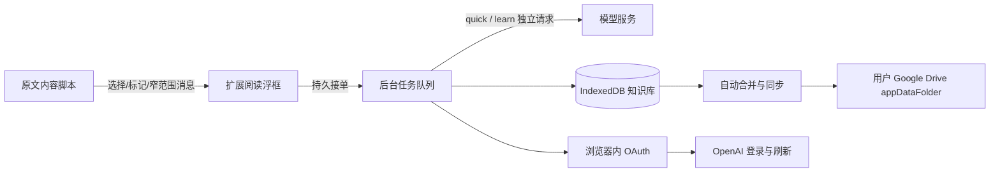

# 架构与数据流

## 代码边界

| 目录 | 职责 |
| --- | --- |
| `src/content` | 正文匹配、已知/待生成标记、选区、语境锚定、浮框定位与网站开关 |
| `src/ui` | 阅读卡、设置、知识库、任务、工具栏及共享组件/外观 |
| `src/background` | 显式模型调用、持久队列、Google 身份与同步协调 |
| `src/shared` | 输入校验、缓存键、模型结构/提示词、知识库与合并 |
| `vendor/siwc-local` | 固定上游源码、测试、来源记录及原许可；产品的浏览器适配位于 `src/background/oauth.mjs` |
| `extension` | manifest 构建输入、稳定公钥、公开 Google 应用 ID、图标和 HTML |
| `test` | 单测、模拟网络服务、隔离浏览器验证；真人服务脚本单独使用 |

## 数据粒度

表达保存标准词形、已确认别名、英美 IPA、常用释义、学习资料和人工修订。语境保存一次具体出现的原句、选区位置、含义、来源与模型信息。句段笔记不自动把所有候选都加入表达库。

上下文和服务配置共同构成缓存身份。同词不同语境分别保存；同一段重复出现的位置不混为一个 occurrence。重新生成绕过缓存，成功后替换指定语境，失败保留旧解释；人工基础释义不被生成结果覆盖。

## 队列与恢复

先持久接单，再派发模型请求。并发 2，短解释优先，学习资料最多并发 1。关闭文章、浮框或知识库不取消任务；浏览器退出后不继续运行。恢复只自动派发未发送任务；已发送但结果不确定的请求显示中断，用户明确重试。

## 同步

Google 为每个设备保存独立快照。字段版本、删除标记、缓存身份并集合并；旧快照不能复活已删除内容。只有上传确认后推进本机同步水位。上传期间的新改动保留 pending，继续调度；授权过期或账号改变会暂停并要求处理。

长期凭据不进入内容脚本、UI、导出或 Drive。[权限细节](privacy.md)与[完整模型调用](model-calling.md)。
