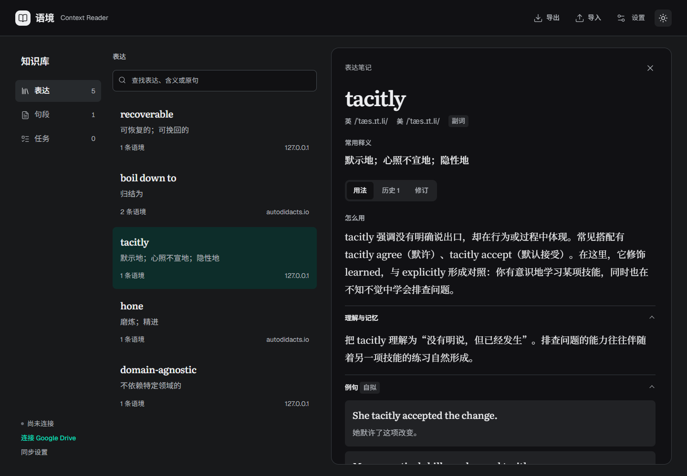
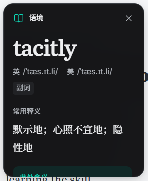
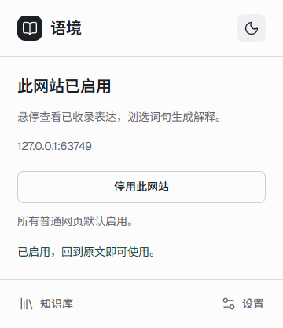

# 界面与验证

界面使用原生 HTML 组件、Radix Colors、Lucide，字号为 14/16/20/44px。英文词头为 Literata，中文释义和学习正文为 Noto Serif SC，IPA 使用 Inter，控件为 Geist/Noto Sans SC。

浮框只有一个正文滚动区。知识库采用导航、列表和详情分区，窄屏在列表与详情间切换。设置按模型、云端、外观和数据分节；低频技术说明折叠。主题切换取消颜色过渡，避免瞬间对比不足；后台更新保留修订草稿、焦点和滚动位置。

## 验证口径

0.7.0 基线在 Windows 的实际 Chrome 扩展中通过 68 项自动测试、45 组浏览器检查。模型和 Google 流量为模拟服务，图片使用模拟账户及知识库；这不构成真实 LLM 输出质量或两台实际设备恢复的证明。

0.7.1 开始每个 PR/主分支构建自动运行检查，最新状态以 [CI](https://github.com/Foolish-Han/ContextReader/actions/workflows/ci.yml) 为准。历史 0.7 基线报告留在 `docs/verification`，不要把它当作之后版本的测试结果。

| 套件 | 覆盖 |
| --- | --- |
| `test:ui` | 浮框、用法/历史、主题、设置、修订草稿、搜索/备份/删除、句段/短语确认、任务错误、键盘与窄屏 |
| `test:cloud` | 模拟 Drive 线请求、取消授权后重试、断开重连、两资料合并、重新生成、离线保留、删除 |
| `test:async` | A/B 并发、C 排队、重入去重、关闭页面继续、worker 中断、明确重试与边界确认 |
| `test:oauth` | 无本机服务的浏览器 OAuth 回调、身份校验、浏览器完全退出后恢复、过期刷新、退出及取消，全部使用合成授权 |
| `test:auto` | 普通网页默认开启、同站点停用、刷新/重启恢复和零模型调用 |

响应式检查覆盖 320/390/768/1024/1440px，阅读卡另检查短视口。

